<div align="center">

# GoHome

**심해 시설을 탐사하고, 물자를 회수해 함께 귀환하는 2–4인 협동 생존 게임**

Unreal Engine 5.7 · C++ · PC Windows / Steam

[게임 플레이 영상](https://naver.me/GNJ0m9Bj) · [개인 기능 종합 시연](https://naver.me/GFsvjfBQ) · [포트폴리오 PDF](Docs/GoHome_Taeho_Eom_Portfolio.pdf)

<a href="https://naver.me/GNJ0m9Bj">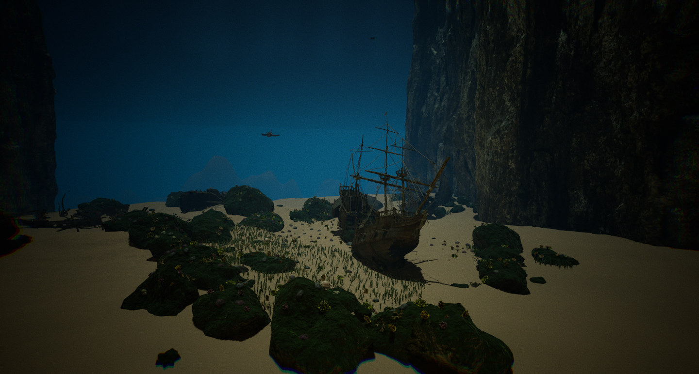</a>

**엄태호 · Gameplay Programmer · [KimHelpMe](https://github.com/KimHelpMe)**

</div>

[협동 운반](#01-협동-운반) · [배전반 퍼즐](#02-배전반-퍼즐) · [아이템·인벤토리](#03-아이템인벤토리) · [조준 개선](#04-레벨-콜리전에-겹친-아이템-조준-개선) · [레벨 갤러리](#05-레벨-123-전체-제작)

## 프로젝트 소개

잠수정에서 탐사를 준비하고, 심해 시설의 위험에 대응하며 물자를 회수하는 협동 게임. 확보한 아이템을 잠수정으로 운반·납품하고 다음 탐사를 준비한다.

**준비 → 시설 탐사 → 물자 회수·협동 운반 → 귀환·정산**

| 항목 | 내용 |
| :--- | :--- |
| 개발 기간 | 2026.08.07 – 2026.10.16 |
| 개발 인원 | 5명 |
| 장르 / 인원 | 수중 협동 생존 / 2–4인 |
| 엔진 / 언어 | Unreal Engine 5.7 / C++ |
| 개인 역할 | 게임플레이 프로그래밍 · **레벨 1·2·3 전체 제작** |
| 개인 포트폴리오 저장소 | [KimHelpMe/Project_GoHome](https://github.com/KimHelpMe/Project_GoHome) |
| 팀 프로젝트 저장소 | [csk9914/GoHome](https://github.com/csk9914/GoHome) |

## 개인 담당

아래 시스템 설명과 개선 사례는 **엄태호 / KimHelpMe의 개인 작업**을 중심으로 정리. 시연 화면에는 팀원이 제작한 HUD·캐릭터·몬스터 등 팀 프로젝트의 결과물이 함께 표시된다.

| 담당 | 핵심 구현·개선 | 적용 기술 |
| :--- | :--- | :--- |
| 협동 운반 | 이동·회전 역할 분리, 공용 시점, 손잡이 추적, 의도치 않은 운반 해제 수정 | 입력 처리, RPC·상태 복제, CharacterMovement 연동 |
| 배전반 퍼즐 | 입력 검증, 정답·오답 상태 분기, 1회용 차단기와 보상 연결 | Server RPC, 상태 관리, 액터 간 연동 |
| 아이템·인벤토리 | 아이템 상태·슬롯 관리, 중복 등록 방지, 납품 연동 | DataAsset, Actor·Component 책임 분리, RepNotify·이벤트 |
| 상호작용 탐지 개선 | 레벨 콜리전에 겹친 아이템의 조준 실패 보정 | Line Trace, Sphere Sweep, 탐색 거리 제한 |
| 레벨 1–3 | **세 레벨의 전체 맵 제작**, 공간 구성·에셋 배치, 레벨 콜리전 수정 | Unreal 레벨 에디터, 콜리전 설정 |

---

## 01. 협동 운반

**두 사람의 역할이 합쳐져 하나의 운반 동작이 되는 구조.**

<a href="https://naver.me/GwflYAW5">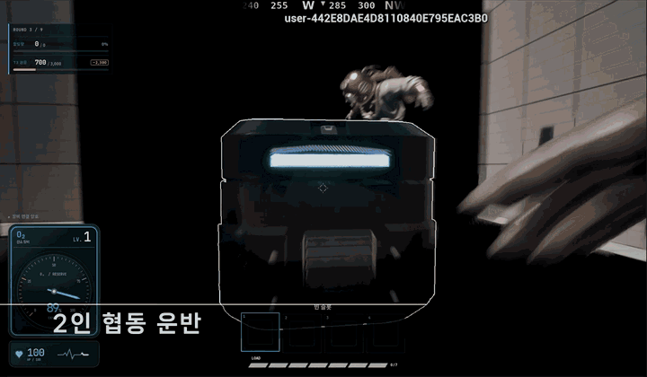</a>

[▶ 협동 운반 전체 시연](https://naver.me/GwflYAW5)

### 문제 → 원인 → 재설계

| 단계 | 내용 |
| :--- | :--- |
| 초기 방식 | 두 운반자의 이동 입력을 평균. 서로 다른 방향을 입력하면 이동이 상쇄되고, 정체·거리 초과 판정으로 운반 해제 |
| 플레이 문제 | 방향을 맞추기 어렵고 반복해서 물체를 다시 잡는 상황 발생. 협동의 재미보다 조작 스트레스 증가 |
| 추가 원인 | 개인 스프린트로 수영 속도 차이 발생. 동일한 합산 입력에도 운반자 간 거리가 벌어져 의도치 않게 해제 |
| 오류 수정 | 운반 중 개인 스프린트 차단, 시작 시 서버·소유 클라이언트의 기존 스프린트 해제. 운반 상태 복제 누락과 이전 입력값 잔존 수정 |
| 조작 재설계 | **이동 담당·회전 담당 분리 + 공용 3인칭 시점**. 정체 시간에 따른 자동 해제 제거 |
| 유지한 규칙 | **몬스터 피격 등 HP 감소 시 두 운반자 모두 해제**. 거리 제한 초과에 따른 해제도 유지 |

<details>
<summary><b>초기 운반 장면과 입력 처리 문제</b></summary>

<p>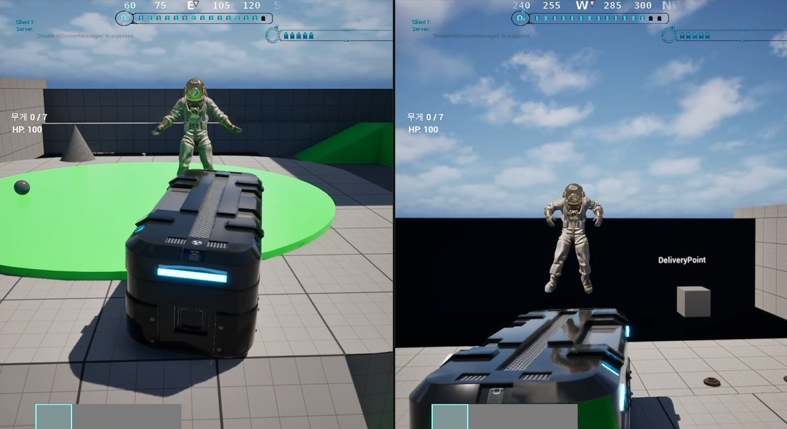</p>

초기 입력 결합의 핵심:

```cpp
const FVector CombinedInput = (InputA + InputB) * 0.5f;
```

반대 방향의 입력이 서로 상쇄되는 구조. 이동 오류를 수정한 뒤에도 남는 조작 불편을 역할 분리로 개선.

| 증상 | 원인 | 수정 |
| :--- | :--- | :--- |
| 클라이언트 입력 미전달 | 운반 상태의 복제 등록 누락 | `DOREPLIFETIME` 등록 |
| 이동 무시·중복 적용 | 서버 직접 이동과 개인 입력 중복 | 로컬 폰에서 합산 입력 적용 |
| 다시 잡으면 자동 이동 | 이전 운반 세션의 입력값 잔존 | 잡기·놓기 시 입력 초기화 |
| 거리 초과로 해제 | 개인 스프린트에 따른 속도 차이 | 서버·소유 클라이언트의 스프린트 상태 해제 |

</details>

### 역할 분담과 공용 시점

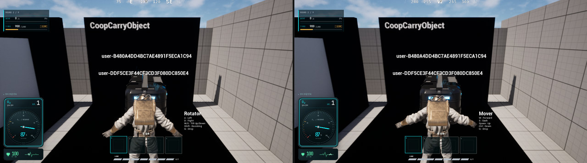

| 이동 담당 · Mover | 회전 담당 · Rotator |
| :--- | :--- |
| `W / S` 전진·후진 | `A / D` 좌우 조향 |
| `Space / Ctrl` 상하 이동 | `W / S` 상하 기울기 |
| 공유 진행 방향을 기준으로 이동 | `Shift` 공유 부스트 |

- 운반 시작 시 역할 배정, 해제까지 유지.
- 공용 카메라로 진행 방향 공유. 서로의 시점 차이에서 생기는 방향 판단 부담 완화.
- 공유 이동에 각 운반자의 **손잡이 추적 보정 입력**을 더해 캐릭터와 물체의 위치 이탈 억제.
- 손잡이를 따라오지 못하면 조향 감속·정지. 평행 이동은 Sweep, 회전은 새 자세의 겹침 검사로 충돌 처리.

<details>
<summary><b>핵심 코드 · 공유 이동과 손잡이 추적</b></summary>

`CoopCarryObjectBase::Tick()` 발췌:

```cpp
const FVector CorrectionA = ((HandleForA->GetComponentLocation()
    - LocationA) / HandleFollowRange).GetClampedToMaxSize(1.f);
const FVector CorrectionB = ((HandleForB->GetComponentLocation()
    - LocationB) / HandleFollowRange).GetClampedToMaxSize(1.f);

CharacterA->SetCombinedCarryInput(SharedMovement + CorrectionA);
CharacterB->SetCombinedCarryInput(SharedMovement + CorrectionB);
```

순간이동·부착 대신 이동 입력으로 손잡이를 추적. 각 로컬 폰의 `AddMovementInput`과 기존 클라이언트 예측 이동 흐름을 유지.

[협동 운반 소스](https://github.com/csk9914/GoHome/blob/1a05779ca3e0eaaa21b45f20a98de0408ab427b9/Source/GoHome/Private/Interaction/CoopCarryObjectBase.cpp)

</details>

### 피격 위험은 유지

| 피격 전 · 협동 운반 중 | 피격 후 · 운반 해제 |
| :---: | :---: |
| 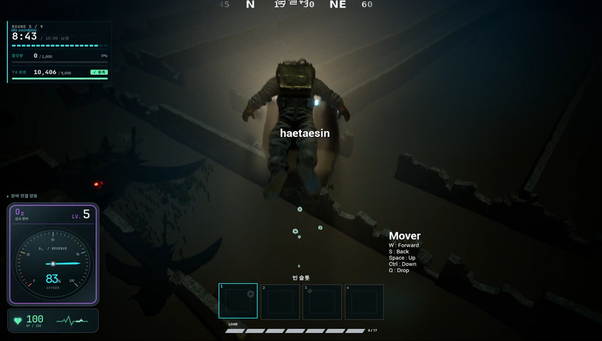 | 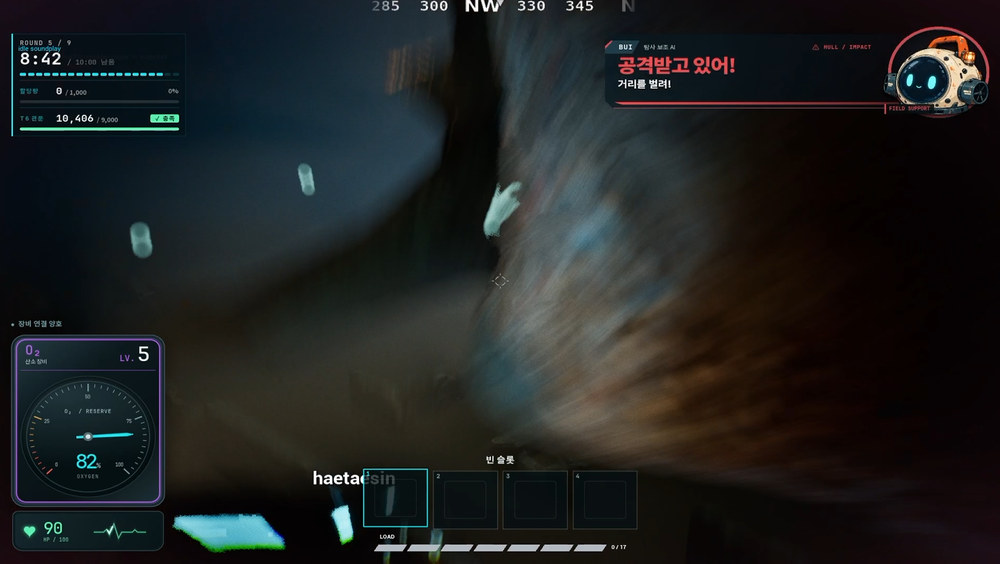 |

**조작 의도는 명확하게, 피격에 따른 위험은 그대로.** 입력 상쇄와 정체로 반복되는 불편을 줄이고, HP 감소에 따른 공동 해제 규칙은 유지.

---

## 02. 배전반 퍼즐

**현재 조작자와 퍼즐 상태를 서버에서 확인한 뒤, 입력 결과를 위험도·차단기·보상에 연결.**

<a href="https://naver.me/GowhMgrd">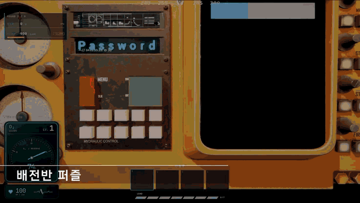</a>

[▶ 배전반 퍼즐 전체 시연](https://naver.me/GowhMgrd)

| 입력 결과 | 상태 전환 | 게임 안에서의 동작 |
| :--- | :--- | :--- |
| 오답 | `Locked` | Risky 등급 입구 개방. 위험 게이지·구역 페널티 유지 |
| 정답 | `Resolved` | 해결 상태로 전환, 차단기 조작 가능 |
| 해결 후 차단기 조작 | `bBreakerFlipped = true` | **1회 조작으로 위험 게이지 초기화·High 등급 입구 개방** |

| 오답 · Failed | 정답 · Succeeded |
| :---: | :---: |
| 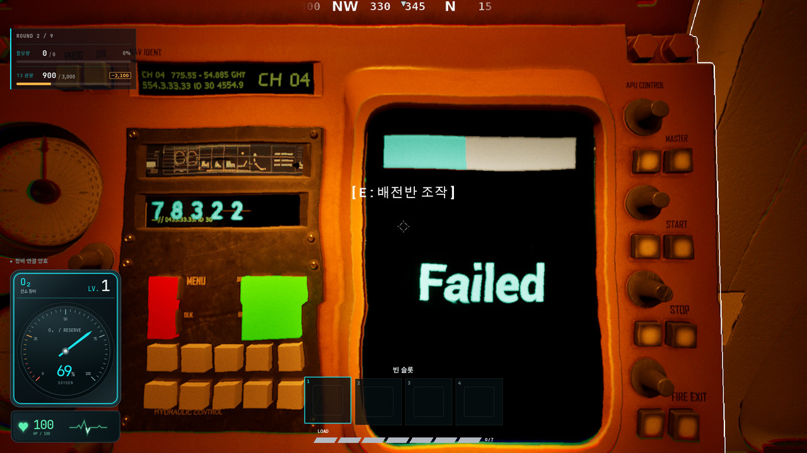 | 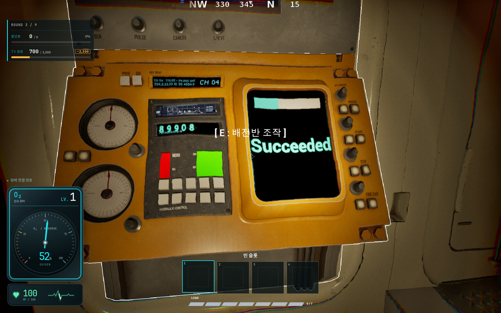 |

<details>
<summary><b>핵심 코드 · 서버 입력 검증과 1회용 차단기</b></summary>

`ServerSubmitPassword_Implementation()`의 검증·분기:

```cpp
if (InInstigator != FocusingPawn) return;
if (SwitchboardState != ESwitchboardState::PuzzleActive) return;

if (EnterDigits == PasswordDigits)
{
    HandlePuzzleSucceeded();
}
else
{
    HandlePuzzleFailed();
}
```

현재 조작자가 아닌 요청과 입력 불가능 상태의 요청을 차단. 검증을 통과한 입력만 정답·오답 처리.

`TryResolveViaBreaker()`는 `CanFlipBreaker()` 확인 후 1회 사용 상태를 기록하고, 위험 초기화와 연결된 보상 입구 개방을 처리.

| 조작 가능 상태의 차단기 | 차단기 조작 후 보상 입구 |
| :---: | :---: |
| 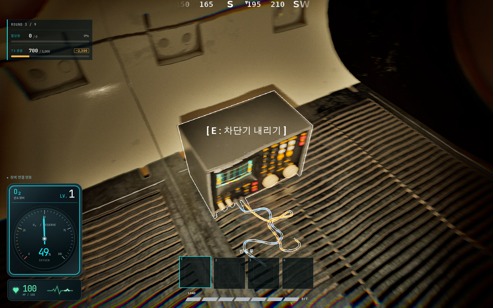 | 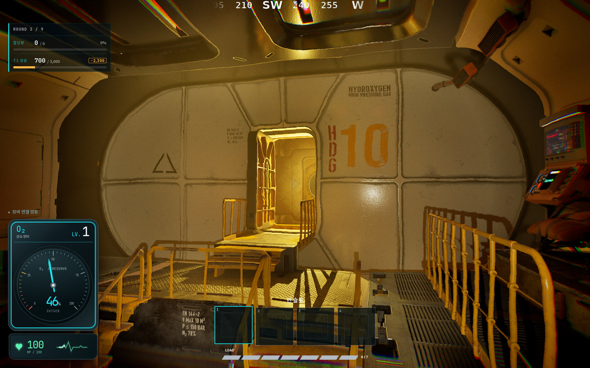 |

[배전반 퍼즐 소스](https://github.com/csk9914/GoHome/blob/1a05779ca3e0eaaa21b45f20a98de0408ab427b9/Source/GoHome/Private/Interaction/ElectricSwitchboardActor.cpp)

</details>

---

## 03. 아이템·인벤토리

**설정 데이터, 월드 상태, 슬롯 관리의 책임을 나누고 획득부터 납품까지 연결.**

<a href="https://naver.me/5OlpHDUP">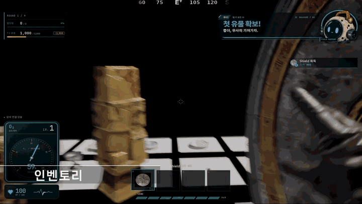</a>

[▶ 인벤토리 전체 시연](https://naver.me/5OlpHDUP)

| 구성 | 책임 |
| :--- | :--- |
| `UItemDataAsset` | 표시 이름·아이콘·무게·가치·파손·소음 설정 |
| `AItemActorBase` | 획득·놓기·파손·소음, 드롭 아이템의 무게에 따른 침강·부상 |
| `UInventoryComponent` | 슬롯 등록·선택·사용, 중복 등록과 빈 슬롯 검사 |
| 납품 연동 | 납품 지점 상호작용, 아이템 가치의 GameState 전달 |

| 획득 후 슬롯 | 납품 후 슬롯 |
| :---: | :---: |
| 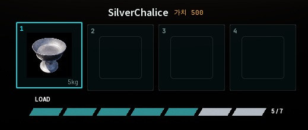 | 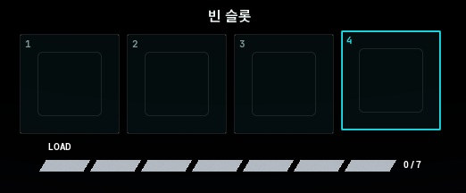 |

- 동일 아이템이 이미 등록된 경우 추가 중단. 빈 슬롯이 없으면 등록 중단.
- 드롭한 아이템은 무게에 따라 침강·부상. 무거운 물자는 가라앉고 가벼운 물자는 떠오르는 수중 동작 처리.
- 서버의 슬롯 변경 및 클라이언트 `OnRep_Slots()`에서 변경 이벤트 전달.
- **인벤토리 변경 이벤트를 팀 HUD에 연동**해 획득·납품 이후 표시 갱신.

<details>
<summary><b>핵심 코드 · 중복 등록 방지와 복제 후 변경 알림</b></summary>

`TryAddItem()` 발췌:

```cpp
for (const FInventorySlot& Slot : Slots)
{
    if (Slot.Item == Item) return false;
}

const int32 EmptyIndex = FindEmptySlotIndex();
if (EmptyIndex == INDEX_NONE)
{
    return false;
}
```

클라이언트에 슬롯이 복제된 뒤 변경 알림:

```cpp
void UInventoryComponent::OnRep_Slots()
{
    OnInventoryChanged.Broadcast();
}
```

슬롯 데이터 관리와 화면 표시의 연결을 이벤트로 분리.

[인벤토리 소스](https://github.com/csk9914/GoHome/blob/1a05779ca3e0eaaa21b45f20a98de0408ab427b9/Source/GoHome/Private/Interaction/InventoryComponent.cpp)

</details>

---

## 04. 레벨 콜리전에 겹친 아이템 조준 개선

**레벨 콜리전이 먼저 시선 검사를 막아, 보이는 아이템을 선택하지 못하는 문제 수정.**

| 수정 전 · 대상 인식 실패 | 수정 후 · 겹친 아이템 선택 |
| :---: | :---: |
| 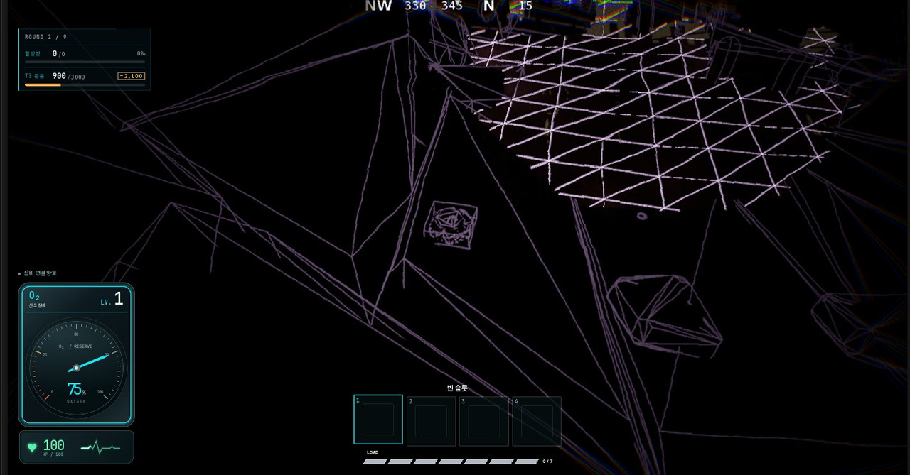 | 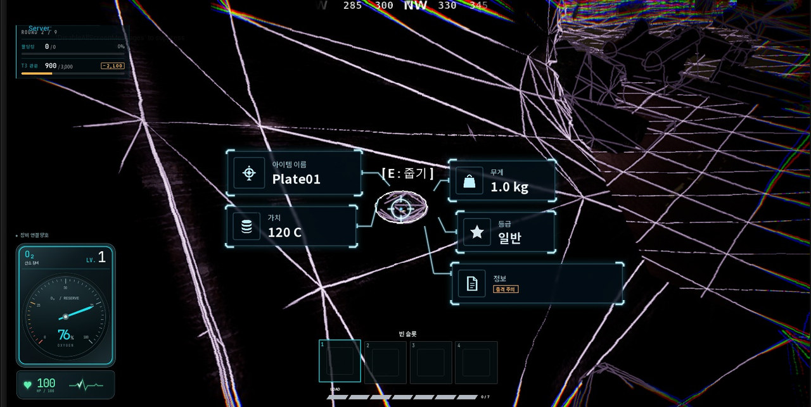 |

| 탐지 순서 | 목적 |
| :--- | :--- |
| 1. 선 트레이스 | 정확히 조준한 대상 우선 |
| 2. 구체 스윕 | 살짝 빗나간 조준 보정 |
| 3. 막힌 지점 근처 추가 탐색 | 앞선 탐지에 실패한 경우만, 허용 거리 안의 아이템 후보 선택 |

추가 탐색의 거리 상한은 `min(전체 사거리, 막힌 거리 + 허용치)`. 기본 허용치는 **50cm**. 기존 조준을 우선하면서 보정 범위 제한.

**남은 한계:** 허용치를 키우면 얇은 벽 너머 아이템 선택 가능. 아이템 수 증가에 따른 후보 수집 비용도 추가 검토 대상.

<details>
<summary><b>핵심 코드 · 탐색 거리 상한과 가장 가까운 후보</b></summary>

`FindItemBehindBlocker()` 조건 발췌:

```cpp
const float MaxDist = FMath::Min(
    TraceDistance, BlockDistance + OverlapAimTolerance);
float BestDist = MaxDist;

// 후보 순회·필터링 생략
if (Item->MeshComponent->SweepComponent(
        ItemHit, Start, End, FQuat::Identity, Shape, false)
    && ItemHit.Distance <= BestDist)
{
    BestDist = ItemHit.Distance;
    Best = Item;
}
```

[상호작용 탐지 소스](https://github.com/csk9914/GoHome/blob/1a05779ca3e0eaaa21b45f20a98de0408ab427b9/Source/GoHome/Private/Interaction/InteractionComponent.cpp)

</details>

---

## 05. 레벨 1·2·3 전체 제작

**세 레벨 모두 전체 맵 제작 담당.** 공간 구성·에셋 배치와 레벨 콜리전 수정.

| LEVEL 01 | LEVEL 02 | LEVEL 03 |
| :---: | :---: | :---: |
| 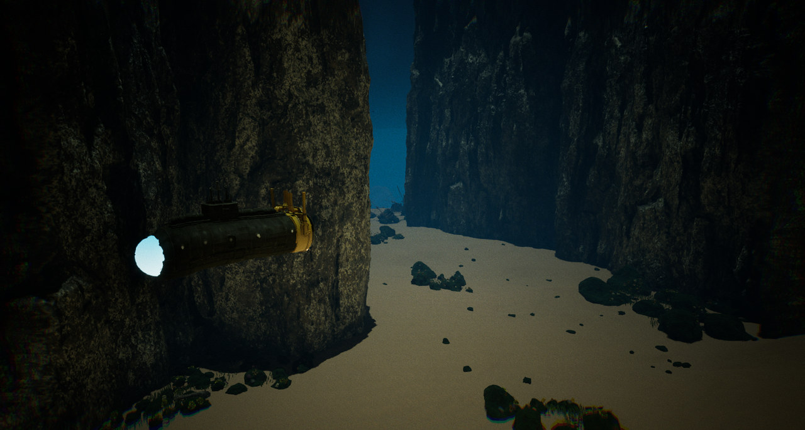 |  | 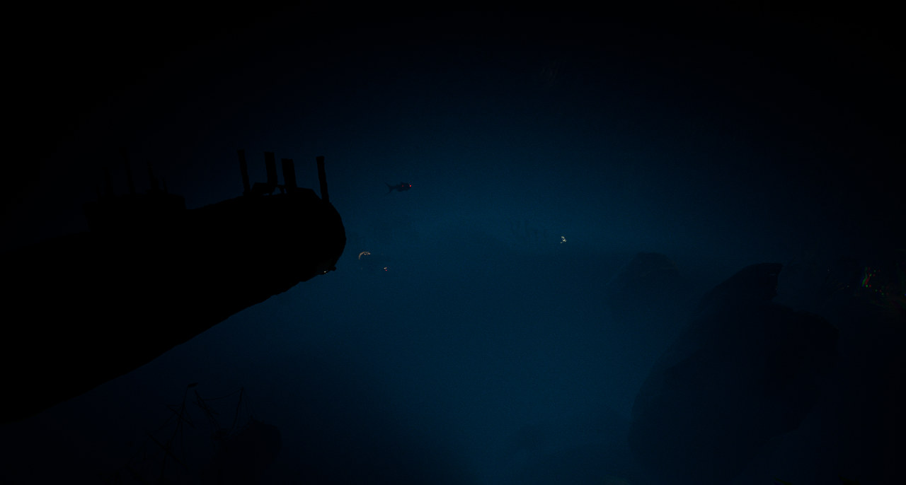 |

- 레벨 2 대형 선박의 콜리전 통과 문제 수정.
- 파괴 벽 타격음·아이템 파손음 추가.
- 텔레포트 사운드 감쇠 범위 수정.

[전체 레벨 스크린샷](https://naver.me/FwGPIibM)

<details>
<summary><b>레벨별 추가 스크린샷 6장</b></summary>

### LEVEL 01

| 침몰선 주변 | 수중 암석·공간 구성 |
| :---: | :---: |
| 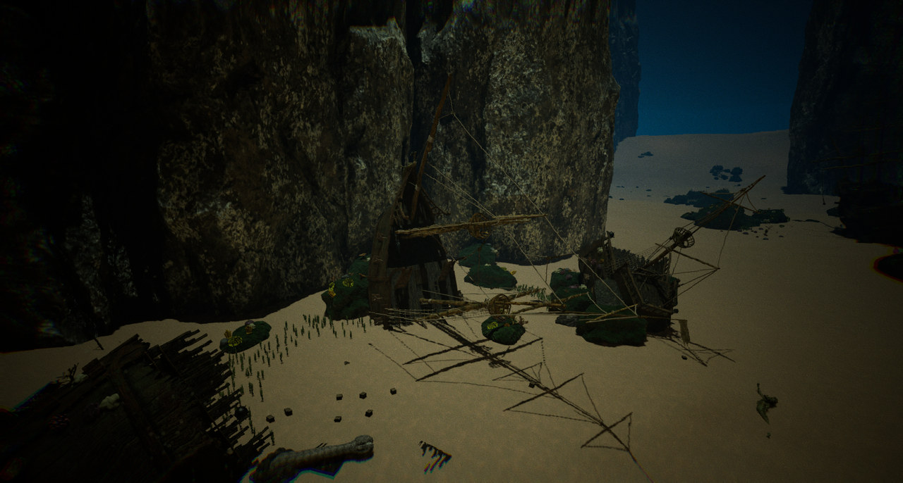 | 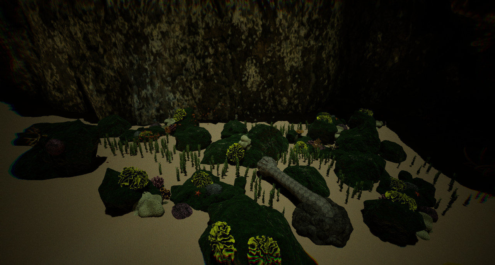 |

### LEVEL 02

| 선박 구조물 | 심해 원경 |
| :---: | :---: |
|  |  |

### LEVEL 03

| 구조물 배치 | 수중 공간 |
| :---: | :---: |
| 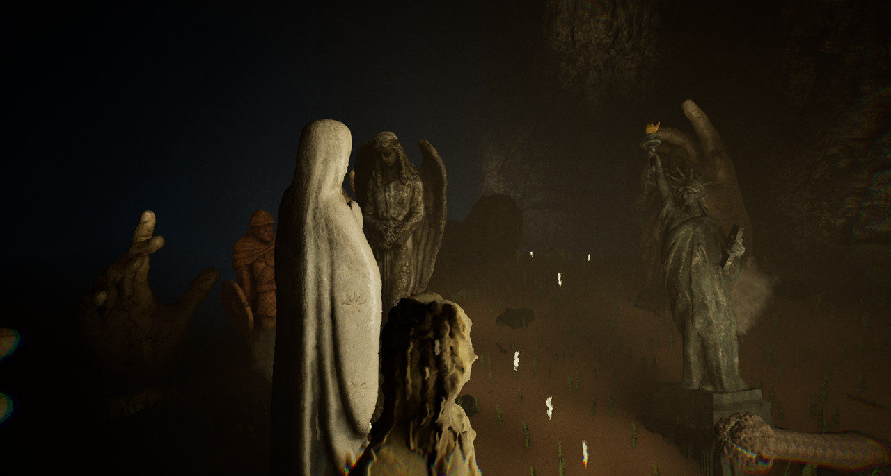 | 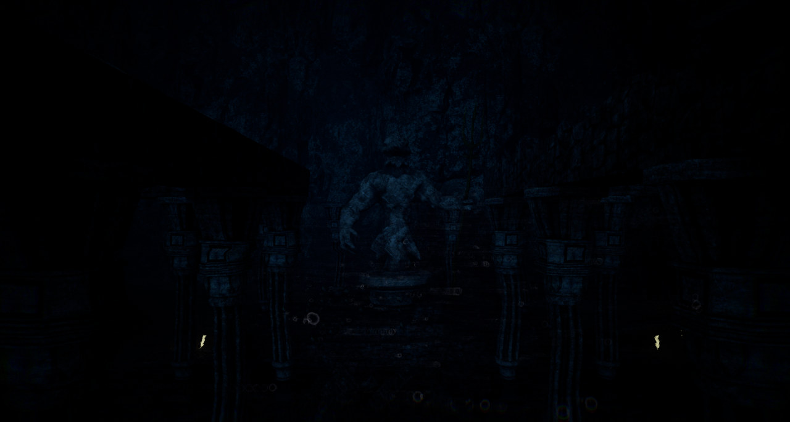 |

</details>

---

## 06. 공통 구조와 적용 기술

상호작용 대상 탐지와 요청은 `UInteractionComponent`, 대상별 동작은 `IInteractable` 구현체에서 처리.

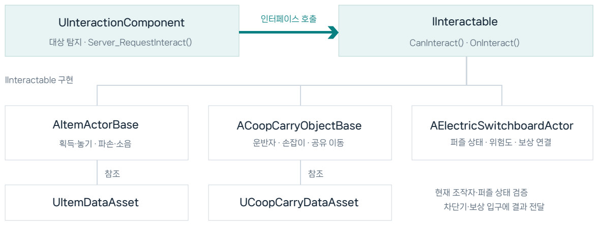

| 기술 | 적용 지점 |
| :--- | :--- |
| C++ / Actor·Component | 상호작용·운반·퍼즐·인벤토리의 책임 분리 |
| Interface | 대상별 상호작용 계약과 공통 호출 |
| DataAsset | 아이템·협동 운반 설정 데이터 분리 |
| Server RPC / Replication / RepNotify | 입력 요청 검증, 운반·퍼즐·슬롯 상태 동기화 |
| CharacterMovement | 운반 합산 입력과 기존 예측 이동 흐름 연동 |
| Trace / Sweep / Overlap | 아이템 탐지 보정, 물체 이동·회전 충돌 검사 |
| Delegate / 이벤트 | 슬롯 변경 이후 팀 HUD 갱신 연결 |
| Unreal 레벨 에디터 | 레벨 1–3 전체 제작, 에셋 배치·콜리전 수정 |

## 링크·연락처

| 자료 | 링크 |
| :--- | :--- |
| 개인 포트폴리오 | [PDF 보기](Docs/GoHome_Taeho_Eom_Portfolio.pdf) |
| 게임 플레이 | [전체 플레이 영상](https://naver.me/GNJ0m9Bj) |
| 개인 기능 종합 시연 | [기능 시연 영상](https://naver.me/GFsvjfBQ) |
| GitHub | [KimHelpMe](https://github.com/KimHelpMe) |
| E-mail | [sssg2248@gmail.com](mailto:sssg2248@gmail.com) |

<div align="center">

**GoHome · 엄태호**  
게임플레이 시스템 구현 · 협동 운반 개선 · 레벨 1–3 전체 제작

</div>
